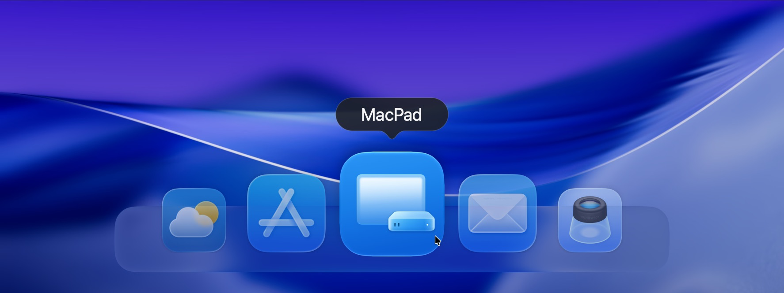
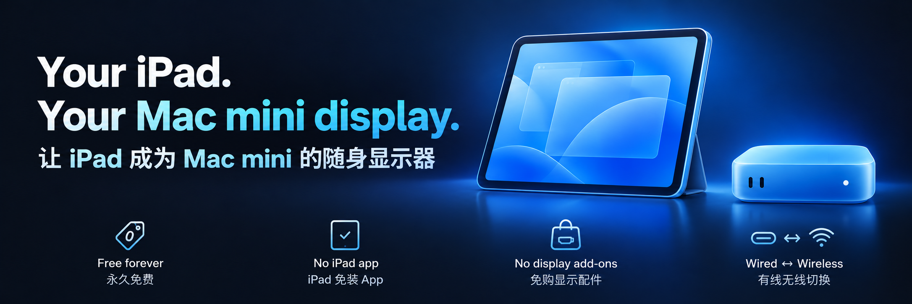
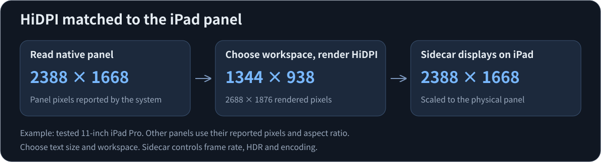

<p align="center">
  
</p>

# MacPad

**English** | [简体中文](README.zh-CN.md)

[Download](https://github.com/Chihao-Sun/MacPad/releases/latest) · [Setup guide](docs/GETTING_STARTED.md) · [Report a problem](https://github.com/Chihao-Sun/MacPad/issues) · [V1.3.2 status](docs/VERSION_STATUS.md)



Turn your iPad into a portable display for your Mac mini. Official MacPad releases will always be free and open source, with no subscription or activation code. Install it on the Mac; the iPad needs no extra app.

Apple Sidecar carries the picture. MacPad keeps a virtual display alive, manages a mirrored desktop, and offers HiDPI sizes suited to the iPad's screen. With compatible devices and accounts, you can use an existing USB-C data cable or connect wirelessly, without buying a capture card or display dummy.

Once you have configured and tested it, MacPad can run from the menu bar after login and connect automatically. Closing its settings window keeps the desktop running.

## Five things you can skip

**Set up your Mac once. Let your iPad reconnect after login.** Enable automatic connection and login launch, then leave the daily Sidecar steps to MacPad. It prefers a data cable when attached, tries wireless when unplugged, and attempts to recover interrupted connections.

| What you can skip | How MacPad handles it |
| --- | --- |
| Paying for MacPad | Official releases are always free and GPL-3.0 open source, with no subscription or activation code. |
| Installing an iPad app | Install MacPad on the Mac. The iPad receives your desktop through Apple Sidecar. |
| A separate BetterDisplay installation | MacPad includes its own virtual display and HiDPI adaptation, generating sizes from the iPad's native pixels and aspect ratio. |
| Extra display accessories | Use wireless or an ordinary data-capable phone/tablet USB-C cable. No capture card, display dummy or special cable is required. |
| Reconnecting by hand every day | After first setup, MacPad finds the iPad after login, manages wired/wireless continuation, and still lets you choose the transport. |

**Use the panel's pixels. Choose text you can read comfortably.** Select larger text, more workspace or a custom size suited to the panel. The iPad and virtual display share one mirrored desktop, keeping the pointer out of a hidden extended area between them. Close settings and keep working from the menu bar.

[Download free MacPad](https://github.com/Chihao-Sun/MacPad/releases/latest) · [Copy an AI setup prompt](docs/GETTING_STARTED.md#start-with-ai-assistance-recommended)

Compatible devices and Apple Account conditions still apply, and MacPad runs after macOS login. The input devices, first setup and startup steps are collected in Important operations below.

## Important operations

> [!IMPORTANT]
> MacPad starts **after macOS login**. It cannot show the FileVault startup screen or enter your password. For monitor-free restart, configure automatic connection and login launch, then rehearse startup with a physical monitor. Missing these steps can leave the iPad without a Mac picture after reboot.

### Start with AI setup

Copy a prompt for [Codex](docs/GETTING_STARTED.md#ai-codex), [Claude Code](docs/GETTING_STARTED.md#ai-claude-code), [Cursor](docs/GETTING_STARTED.md#ai-cursor), or [ChatGPT / Claude / Gemini / DeepSeek](docs/GETTING_STARTED.md#ai-chat-assistant). An agent with local tools can perform installation and settings; other assistants can guide you. You handle system confirmations, iPad unlock, password entry and picture verification.

### First setup

1. Keep a physical monitor attached and have your own keyboard and a mouse or trackpad connected to the **Mac mini**, not only to the iPad. Check the compatibility section below.
2. Confirm [Apple's Sidecar requirements](https://support.apple.com/en-qa/102597): compatible devices, the same Apple Account, and two-factor authentication. For wireless, enable Wi-Fi, Bluetooth, and Handoff and keep the devices within 10 metres. Do not share the iPad's cellular or the Mac's Internet connection.
3. Download the Apple Silicon DMG from [Releases](https://github.com/Chihao-Sun/MacPad/releases/latest). Open it, drag MacPad.app into Applications, and launch that permanent copy. Keep one installed copy; do not set login launch from the mounted DMG.
4. The package is **ad-hoc signed and not Apple notarized**. If macOS blocks it, review the source and checksum, then follow [Apple's instructions](https://support.apple.com/en-au/102445) for that app in Privacy & Security. Do not disable system-wide protections.
5. **The first connection may be wireless.** Unlock the iPad and select Automatic in MacPad. A prior USB connection is not required. Alternatively, connect a data cable and trust the Mac when prompted. The original Apple USB-C cable supplied with a USB-C iPhone or iPad is normally suitable; a charge-only cable is not. No Thunderbolt cable is needed. Finder sync and backups are unnecessary.
6. Open MacPad from the menu bar, choose the iPad, and select Connect. Check the picture, keyboard, and mouse, then choose a Display size. Presets and Custom let you adjust text size and workspace.
7. For automatic use after login, enable **connect when no physical monitor is present** and **launch after Mac login**. Approve MacPad under System Settings → General → Login Items if macOS requests it. Enable automatic wired/wireless switching if you want both methods to follow cable changes.
8. Unplug only the physical monitor's video cable and check the iPad desktop. If you use both transports, test data-cable unplug/replug separately. Keep a recovery monitor nearby for the first restart test.

### Restart without a visible login screen

**Rehearse this with a physical monitor first.** A keyboard that works after login is not proof that it works at the FileVault screen. Pair the wireless keyboard with the Mac mini, charge it, and confirm it can type at startup. A keyboard attached only to the iPad cannot enter the Mac's startup password through Sidecar. Keep a tested wired connection or USB receiver available if your keyboard needs one.

1. Save work and shut down normally. Remove power only after shutdown. On arrival, connect Mac mini power and press its power button. Keep the iPad awake and unlocked, with the chosen wired or wireless conditions ready.
2. Turn on the Mac-connected keyboard and wait for the startup stage established during rehearsal. Check Caps Lock and the input layout you tested. Use a harmless modifier such as Shift to wake the keyboard if needed.
3. Follow the account/focus sequence you verified. If the default account's password field is already focused, type the password once and press Return. If rehearsal showed an account tile first, use the verified key sequence to open its password field before typing. Multiple accounts and OS updates can change this sequence; there is no universal blind-login key sequence.
4. After the correct password is accepted, macOS enters the user session. MacPad then launches, retains a virtual desktop, and searches for the iPad. Allow the system time to finish login and discovery.
5. If no picture appears, avoid repeatedly typing passwords blindly. Unlock the iPad and try its data cable; if necessary, reconnect the recovery monitor and inspect the actual login or connection state.

We recommend keeping a login password and FileVault enabled. MacPad does not save or type passwords and does not require macOS automatic login. Automatic login is a separate OS setting; FileVault restricts its availability. Removing local login protection makes a lost or stolen Mac easier to access.

### Daily use, recovery and updates

- Close the settings window to keep MacPad running in the menu bar. Quitting removes its virtual display.
- Unplug the data cable to try wireless; reinsert it to return to wired. Switching may briefly interrupt the picture. A temporary manual transport choice resets on the next cable change or login.
- If a cable is attached but Automatic still shows wireless, check that macOS has recognized the USB iPad. Charging alone does not establish a data connection. Unlock the iPad, reseat the cable and handle any accessory or trust prompt; try a cable known to carry data if it remains unrecognized. MacPad prefers wired once the USB connection is detected.
- Disconnect pauses automatic connection. Select Connect to resume. After repeated failures, unlock the iPad and reconnect its cable or retry manually; ordinary refresh does not restart an unlimited retry loop.
- Attach a spare monitor before updating or quitting when the iPad is your only display. Before uninstalling, disable login launch in MacPad, quit, and remove the app. Local diagnostics are described in [privacy notes](docs/PRIVACY.md).

The [standalone setup guide](docs/GETTING_STARTED.md) contains these operations for use away from the README. Rehearse cable changes and login separately; one successful manual connection does not prove monitor-free startup. Fully offline operation still needs a separate test.

## How display sizes work




MacPad reads the Sidecar display's native pixel dimensions, then generates desktop sizes with the same aspect ratio. It does not apply one 11-inch preset list to every iPad. If detection fails, the interface labels the compatibility fallback instead of presenting it as a detected panel.

On the tested 11-inch iPad Pro, the default desktop is 1344 × 938, rendered at 2688 × 1876 and scaled to a 2388 × 1668 panel. Other panels get sizes calculated from their reported pixels. These examples belong to the tested panel:

| Desktop size | Rendered pixels |
| --- | --- |
| 1194 × 834 | 2388 × 1668 |
| 1280 × 894 | 2560 × 1788 |
| 1344 × 938 (default) | 2688 × 1876 |
| 1600 × 1118 | 3200 × 2236 |
| 2388 × 1668 | 4776 × 3336 |

Use Display size or Custom to choose a desktop. Keep iPad aspect ratio is on by default. Custom dimensions must cover the panel pixels and fit within the framebuffer limits. Larger rendered desktops cost more graphics and encoding work; Sidecar controls the final frame rate and transmission quality. HiDPI does not imply a one-to-one panel mapping at every size.

## Latency and switching

In our current indoor setup, everyday wireless use has felt close to USB-C wired use. This is a subjective usage observation, not a measured latency comparison; conditions can vary with the wireless environment.

| Measurement | Evidence so far |
| --- | --- |
| USB-C picture latency | End-to-end latency has not been measured; no millisecond figure is published. |
| Wireless picture latency | End-to-end latency has not been measured; no millisecond figure is published. |
| Recovery after unplugging a data cable | An earlier test recovered in about 5 seconds. In the latest V1.3.1 session, stable wireless verification took about 8 seconds. |
| Return to wired after cable reinsertion | In the latest V1.3.1 session, stable wired verification took about 6 seconds. |

Picture latency measures an input-to-visible-response delay. Recovery time measures how long it takes for the picture to return after unplugging. Switching can briefly interrupt the picture; there is no zero-interruption or fixed-time guarantee.

## Compatibility and limits

V1.3.2 provides an arm64 build with a macOS 14 minimum compilation target. Physical testing covers one M4 Mac mini on macOS 26.6.2 and one second-generation 11-inch iPad Pro. The iPadOS version has not been recorded. No Intel build is supplied, and other OS versions still need testing.

Different native dimensions and portrait/landscape ratios have policy tests. That is not physical acceptance of other iPad models. MacPad depends on internal system interfaces, which can change with macOS updates. Both devices must still qualify for Apple Sidecar.

MacPad works after login. It does not display the FileVault startup unlock screen, save your password, or enable automatic macOS login. Fully offline operation, real sleep/wake, and forcing wireless while the cable stays attached have not been separately verified. It does not provide remote desktop across the public Internet or full macOS finger-touch input.

## Build from source

On an Apple Silicon Mac, install Xcode or command-line developer tools with the required macOS SDK, and have Python 3 available:

```sh
zsh scripts/test.sh
zsh scripts/build.sh
```

The app is generated in `.build/Release.noindex/<VERSION>/MacPad.app`. The build script increments internal BUILD and applies an ad-hoc signature. It does not automatically install, replace, or launch the app.

Compilation and policy tests do not establish notarization, physical-device acceptance, or a successful cold boot. Keep a physical monitor attached for the first use of a self-built app.

## License, privacy and contributions

MacPad is free under [GPL-3.0-only](LICENSE), including its supplied project artwork. Commercial use is permitted; distributing modified versions requires compliance with the GPL and corresponding source obligations. Apple's system components are governed by their own terms and are not distributed here.

Diagnostics stay on your Mac and are not uploaded automatically. Review logs and screenshots before sharing them and remove personal device names, local paths, and private content. Read the [privacy notes](docs/PRIVACY.md) and [contribution guide](CONTRIBUTING.md).
