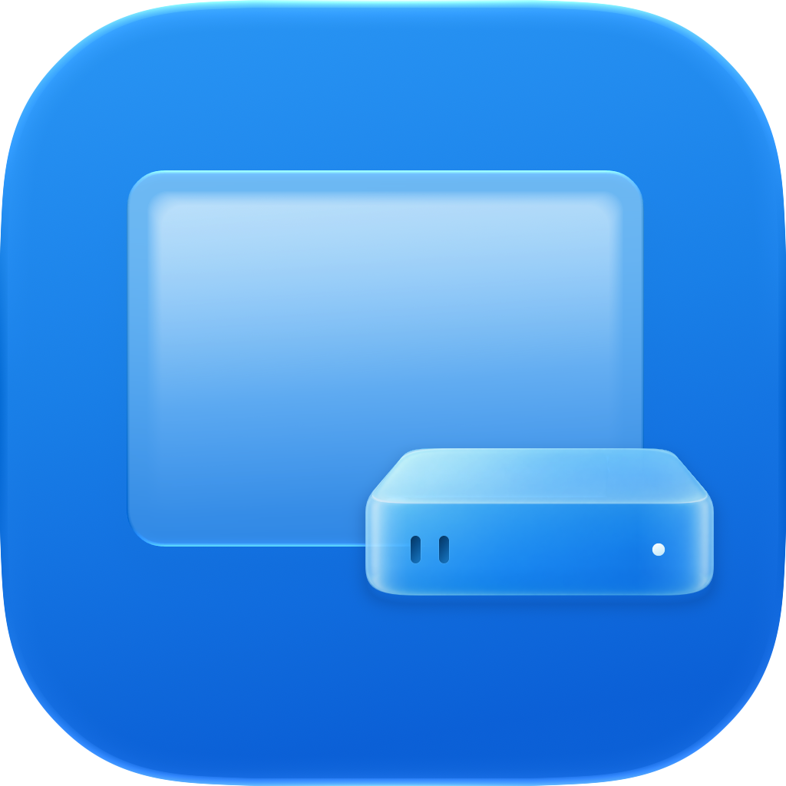

<p align="center">
  
</p>

# MacPad

[English](README.md) | **简体中文**

[下载安装包](https://github.com/Chihao-Sun/MacPad/releases/latest) · [首次配置](docs/首次配置.md) · [问题反馈](https://github.com/Chihao-Sun/MacPad/issues)

让 iPad 成为 Mac mini 外出办公的随身显示器。MacPad 官方版本永久免费开源，无订阅、无激活码，只需在 Mac 上安装和配置，iPad 不用另装软件。

它使用 Apple 原生随航传输画面，再用虚拟屏幕维持桌面、生成适合 iPad 的高清分辨率。两端满足随航要求时，无需购买采集卡或显示器诱骗器；有线使用能传数据的 USB-C 线，也可以无线连接。

首次配置并验证好后，MacPad 可以随登录在菜单栏运行，按设置自动连接 iPad。日常关闭设置窗口即可继续使用，系统暂时断开时会进行有界恢复尝试。连续失败后等待设备重新就绪，避免反复弹出系统错误窗。

## 我们优化了哪些操作

- 只在 Mac 端安装，iPad 无需额外安装 App。
- 不用另装 BetterDisplay：MacPad 自带独立实现的虚拟屏幕与高清适配能力。
- 无需采集卡、显示器诱骗器、专用线缆或付费第三方显示软件授权。可无线使用，也可用接口匹配、支持数据传输的普通手机或 iPad USB-C 原装充电线辅助连接。

- 按 iPad 屏幕能力适配高清显示：根据原生像素与比例生成覆盖面板的高清档位，尽可能充分利用清晰度与显示空间；文字大小、桌面空间和自定义尺寸由用户选择。刷新率、HDR 与传输压缩仍由 Apple 随航决定。

- 拔掉实体显示器后，虚拟屏幕继续保留桌面，iPad 可以作为登录后的唯一屏幕。
- iPad 与虚拟屏保持同一个镜像桌面，鼠标和窗口不会跑到这两块屏幕之间的隐藏扩展区域。
- 开启登录启动与自动连接后，进入 Mac 桌面就会尝试连接，不必每次再去系统设置里打开随航。
- 数据线接入时优先有线，拔线后尝试无线，插回后尝试恢复有线；也可以临时手动选连接方式。
- 读取 iPad 的原生像素和比例，自动生成高清档位。可以选文字更大或空间更多的桌面，也可以自定义宽高，并按设备记住选择。
- “断开”会暂停自动连接，“连接”会恢复。关闭窗口只收起设置，顶部菜单栏和桌面连接继续运行，无需常驻 Dock。
- 系统连接请求未结束时不会重复发起，超时后也保留请求状态；同一设备状态周期最多尝试三次，之后等待重新发现设备、插拔线缆、唤醒或手动重试。系统自身仍可能显示一次连接失败提示。
- 设置页显示实际连接方式和连接记录；显示大小应用成功并确认镜像后才保存，失败会保留原桌面。

### 高清是怎么实现的

画面传输由 Apple 随航完成。MacPad 的虚拟屏幕负责桌面尺寸和高清渲染：先识别 iPad 面板，再按它的比例生成显示大小，避免把同一套 11 英寸分辨率用于所有 iPad。

在已经验证的 11 英寸 iPad Pro 上，默认桌面是 1344 × 938，渲染为 2688 × 1876，再显示到 2388 × 1668 的面板。其他尺寸使用系统报告的面板像素生成档位。识别不到时会明确显示兼容状态，不把回退尺寸当成已经识别的屏幕能力。

你可以从“显示大小”选择档位，或打开“自定义…”输入宽高。“保持 iPad 屏幕比例”默认开启。软件会检查尺寸和画布上限，避免低于面板像素覆盖或创建过大的高清画布。渲染更大的桌面也会增加图形与编码开销，最终帧率和传输质量仍由系统随航决定。

## 重要操作

> [!IMPORTANT]
> **必须先进入 macOS 用户桌面，MacPad 才会启动并寻找 iPad。** 它不能显示 FileVault 开机解锁画面，也不会代输密码。要在无实体显示器时重启使用，必须完成自动连接与登录启动配置，并先有屏演练。省略这些步骤，重启后可能无法在 iPad 上看到 Mac 桌面。

### 第一次配置

1. 保留实体显示器，自备能连接并操作 **Mac mini** 的键盘，以及鼠标或触控板，而不是只连接到 iPad 的键鼠。先核对下方兼容范围。
2. 确认符合 [Apple 随航要求](https://support.apple.com/en-qa/102597)：兼容设备、同一 Apple 账户、双重认证。无线连接需两端开启 Wi-Fi、蓝牙和接力，距离不超过 10 米；iPad 不共享蜂窝网络，Mac 不共享互联网连接。
3. 从 [Releases](https://github.com/Chihao-Sun/MacPad/releases/latest) 下载 Apple Silicon 版 DMG。打开后把 MacPad.app 拖入 Applications，再从固定应用程序目录启动。只保留一个日常应用副本，不从挂载的 DMG 设置登录启动。
4. 当前包为 **ad-hoc 本地签名、未 Apple 公证**。首次若被拦截，先核对来源与校验值，再按 [Apple 指引](https://support.apple.com/en-au/102445) 在“隐私与安全性”里处理这个 App 的提示，不关闭系统整体安全保护。
5. **第一次就可以无线连接，不要求先用 USB 配对。** 保持 iPad 解锁，在 MacPad 选择“自动”。也可用数据线连接，按系统提示信任 Mac。USB-C 版 iPhone、iPad 随附的苹果原装线通常可以使用，必须支持数据传输，仅充电的线不行；不用雷雳线，也不需要访达同步或备份。
6. 从顶部菜单栏打开 MacPad，选择 iPad 并点击“连接”。确认画面、键盘和鼠标正常，再通过“显示大小”或“自定义…”调整文字大小和桌面空间。
7. 要在登录后自动使用，必须开启 **“没有实体显示器时自动连接”** 和 **“登录 Mac 后启动”**。系统要求时，在“系统设置 → 通用 → 登录项”允许 MacPad。需要插拔线自动切换时，再开启“自动切换有线与无线”。
8. 只拔掉实体显示器的视频线，确认 iPad 桌面正常。若要使用两种连接方式，分别测试数据线拔出后的无线接续、插回后的有线接续。首次重启试验请把恢复用显示器放在手边。

### 重启后怎样盲打密码

**先接实体显示器演练一次。** 键盘在登录后能用，不代表它在 FileVault 开机界面也能用。无线键盘必须与 Mac mini 配对、有电，并提前确认能在开机解锁界面输入。只连接 iPad 的键盘，不能通过尚未启动的随航输入 Mac 开机密码；若你的键盘需要，请备好已验证的键盘有线连接或 USB 接收器。

1. 保存工作并正常关机，关机完成才拔电。外出后接好 Mac mini 电源，按开机按钮；iPad 保持亮屏解锁，有线或无线条件按选择准备好。
2. 打开连接到 Mac 的键盘，等待到演练时确认的登录阶段。确认大小写锁定与输入法布局；必要时用 Shift 等不输入字符的按键唤醒键盘。
3. 按已经演练过的账户和焦点顺序操作。若默认账户的密码框会自动获得焦点，输入一次密码并回车；若演练时先显示账户图标，则先用已确认的按键顺序进入密码框再输入。多账户、系统更新等可能改变界面，不能保证所有 Mac 都用同一套盲打按键。
4. 密码被接受后，macOS 进入用户桌面。此时 MacPad 才随登录启动，保留虚拟桌面并寻找 iPad；给系统完成登录与发现设备留出时间。
5. 若没有画面，不要反复盲输密码。先解锁 iPad、尝试数据线；必要时接回恢复用显示器，检查实际登录和连接状态。

建议保留登录密码和 FileVault。MacPad 不保存、不代输密码，也不要求开启系统自动登录。自动登录是独立的 macOS 设置，其可用性受 FileVault 限制；取消本地登录保护，会增加 Mac 遗失或被他人拿到后的访问风险。

### 日常使用、恢复与更新

- 关闭设置窗口后，MacPad 仍在菜单栏运行；退出会移除它保留的虚拟屏幕。
- 有线切无线直接拔数据线，切回有线直接插回；期间可能短暂黑屏。临时手动指定连接方式后，下次线缆变化或重新登录会恢复自动策略。
- “断开”表示暂停自动连接，“连接”表示恢复。连续失败后可解锁 iPad、重新插线或手动重试；普通刷新不会启动无限重试。
- 仅用 iPad 显示时，更新或退出前先接备用显示器。卸载前关闭应用内登录启动，再退出并移除 App；本地诊断见 [隐私说明](docs/隐私说明.md)。

[独立配置指南](docs/首次配置.md) 汇集相同操作，便于单独查看。线缆切换与重启登录分别演练；一次手动连接成功不代表无屏启动已经验证。完全离线仍需要单独测试。

## 延迟与连接切换

在目前的室内使用中，日常无线体验与 USB-C 有线接近。这是使用感受反馈，尚不是端到端延迟测量；无线环境变化可能影响体验。

| 项目 | 当前测量情况 |
| --- | --- |
| USB-C 画面延迟 | 尚未完成端到端测量，没有可公布的毫秒数。 |
| 无线画面延迟 | 尚未完成端到端测量，没有可公布的毫秒数。 |
| 有线切无线的恢复时间 | 此前设备实测中，用户观察约 5 秒恢复，日志约 5 秒显示上线、约 6 秒完成稳定校验。 |

画面延迟是操作到 iPad 显示变化的时间；恢复时间是拔线后等画面重新出现的时间。两者分别统计。有线与无线可以自动接续，期间可能短暂黑屏，当前不承诺零中断或固定恢复秒数。

## 兼容范围和使用边界

当前源码版本为 V1.3.1，提供 arm64 构建，编译最低目标为 macOS 14。实际设备验证只覆盖 M4 Mac mini、macOS 26.6.2 和一台 11 英寸第二代 iPad Pro；iPadOS 具体版本尚未登记。未提供 Intel 构建，其他系统版本还需要验证。

不同尺寸和横竖比例已有策略测试，不能当作其他 iPad 型号已经完成真机验收。软件依赖系统内部接口，macOS 升级可能影响兼容性，且两端仍须满足 Apple 随航的设备与账户要求。

MacPad 在登录后工作，不显示 FileVault 开机解锁画面，不保存密码，也不启用系统自动登录。完全离线、实际睡眠唤醒以及插线时手动强制无线尚未分别验收。它不提供跨公网远程桌面，也不把 iPad 变成完整的 macOS 手指触摸屏。

<details>
<summary>11 英寸 iPad Pro 的显示大小示例</summary>

| 桌面大小 | 实际渲染像素 |
| --- | --- |
| 1194 × 834 | 2388 × 1668 |
| 1280 × 894 | 2560 × 1788 |
| 1344 × 938（默认） | 2688 × 1876 |
| 1600 × 1118 | 3200 × 2236 |
| 2388 × 1668 | 4776 × 3336 |

这些是这块面板的档位示例。其他面板会按自身像素和比例生成选项；高清渲染不代表每档都与面板一对一映射。

</details>

<details>
<summary>从源码构建</summary>

在 Apple Silicon Mac 上安装 Xcode 或包含所需 macOS SDK 的命令行开发工具，并准备 Python 3：

```sh
zsh scripts/test.sh
zsh scripts/build.sh
```

应用生成于 `.build/Release.noindex/<VERSION>/MacPad.app`。构建脚本会递增内部 `BUILD`，只生成和本地签名，不自动安装、替换或启动应用。

本地编译通过不代表 Apple 公证通过。策略与几何测试也不能代替真实 iPad、物理拔插或冷启动测试。首次试用自己编译的 App 时保留外接显示器。

</details>

## 开源、隐私与贡献

MacPad 免费发布，代码和随附的项目资源采用 [GPL-3.0-only](LICENSE)。允许商业使用；分发基于本项目的修改版时，须遵守 GPL 并提供相应源码。Apple 的系统软件与框架由其各自条款管理，不随本仓库分发。

诊断保存在本地，不自动上传。提交问题前，请检查并移除日志和截图中的个人设备名称、路径及私密内容。详见 [隐私说明](docs/隐私说明.md) 和 [贡献指南](CONTRIBUTING.zh-CN.md)。
